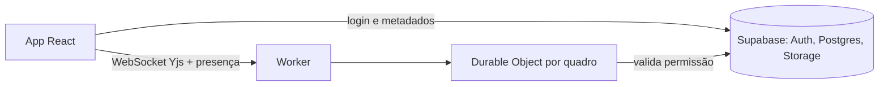

# Stack futura

Levantamento feito em novembro de 2026 para as funcionalidades que dependem de backend. Preços e limites mudam: confirme nas páginas oficiais antes de contratar.

## Recomendação

| Necessidade | Escolha | Por quê |
| --- | --- | --- |
| Sincronização | **Yjs** | CRDT mais maduro, cerca de 18 kB gzip e sem WASM |
| Servidor de tempo real | **Cloudflare Durable Objects + `y-partyserver`** | Um objeto por quadro, sem servidor para operar; hibernação evita pagar por conexão ociosa |
| Login, banco e permissões | **Supabase** (Auth + Postgres + RLS) | Um só serviço, e o usuário fica no seu Postgres |
| Imagens | **Supabase Storage** | Já autenticado pelo mesmo login e pelas mesmas políticas |
| Hospedagem do frontend | **Vercel** (em uso) | Deploy e previews via GitHub Actions; o build é estático |



## Colaboração ao vivo

| Opção | Prós | Contras |
| --- | --- | --- |
| **Yjs + y-partyserver** (recomendada) | Convergência pronta, undo por usuário (`Y.UndoManager`), presença (awareness), open source | O operador é você; requer conta Cloudflare |
| Yjs + Hocuspocus | MIT, auto-hospedável, extensões de autenticação e banco | Servidor Node para operar e escalar por sala |
| Liveblocks | Mais rápido de lançar; presença e comentários prontos; aceita Yjs | Fechado. Free: 500 salas ativas/mês e 10 conexões por sala. Pro: US$ 25/mês |
| Modelo do Excalidraw: relay + versão por elemento | Permite criptografia de ponta a ponta com servidor que nada guarda | Undo multiusuário sem solução pronta; precisa de tombstones e resolução próprios |
| Automerge | Histórico estilo Git | Cerca de 320 kB de WASM; ecossistema menor |
| Loro | Melhor desempenho em benchmark | Mais jovem; integração quase toda manual |

**Custo do Durable Objects** (plano pago, mínimo de US$ 5/mês): 1 milhão de requisições/mês inclusas, depois US$ 0,15 por milhão; mensagens WebSocket recebidas contam na proporção 20:1 e as enviadas são grátis; 400 mil GB-s/mês inclusos. Há plano gratuito com 100 mil requisições/dia e 5 GB de SQLite.

### Como encaixa no código atual

- **Documento:** um `Y.Map` de `id → elemento`. O elemento inteiro é a unidade de conflito (vence a última escrita), o mesmo nível de granularidade do Excalidraw.
- **Diferenças locais:** como os elementos são imutáveis, basta comparar referências para saber o que enviar.
- **Ordem das camadas:** hoje é a posição no array. Precisa virar campo `index` fracionário, senão duas pessoas reordenando geram conflito.
- **Desfazer:** trocar `past/future` por `Y.UndoManager` limitado às edições locais.
- **Presença:** cursor, seleção, nome e cor vão em awareness, nunca no documento.
- **Frequência:** limitar o envio durante o arraste a algo como 20 a 30 vezes por segundo.
- **Setas ligadas:** a posição é derivada da forma; recalcular ao receber atualização, sem transmitir duas vezes.
- **Imagens:** sair de data URL para arquivo enviado ao Storage, com id igual ao hash do conteúdo.

## Login

| Opção | Prós | Contras |
| --- | --- | --- |
| **Supabase Auth** (recomendada) | Integra com RLS e Storage; Free com 50 mil MAU; Pro desde US$ 25/mês com 100 mil MAU | UI própria; equipes e convites são por sua conta |
| Better Auth | Open source, sem custo por usuário, baixo aprisionamento | Requer backend próprio para rodar sessões e limites |
| Clerk | Melhor UI pronta e organizações | Custo por usuário ativo e migração difícil |

O plano Free do Supabase tem 500 MB de banco, 1 GB de arquivos e **pausa o projeto após 1 semana sem uso**: serve para desenvolvimento, não para produção.

Provedores sugeridos no início: Google, GitHub e link mágico por e-mail.

### Autenticação no WebSocket

O `YProvider` envia dados de autenticação por query string, que costuma aparecer em logs. Em vez do JWT, enviar um ticket de uso único com vida de cerca de 60 segundos, emitido pelo Worker após validar a sessão do Supabase e a permissão no quadro.

## Modelo de dados inicial

```text
profiles       id (auth.users), nome, avatar_url
boards         id, owner_id, title, created_at, updated_at, thumbnail_path
board_members  board_id, user_id, role (owner | editor | viewer)
share_links    token_hash, board_id, role, expires_at, revoked_at
board_files    board_id, content_hash, storage_path, mime, bytes
```

O estado do desenho fica no SQLite do Durable Object; o Postgres guarda apenas metadados. Todas as tabelas com RLS ligada desde a primeira migração.

## Decisão pendente: criptografia de ponta a ponta

É preciso escolher antes da fase de colaboração, porque muda a arquitetura:

- **Sem E2EE (recomendado para começar):** habilita miniaturas, busca e histórico no servidor. O servidor consegue ler os quadros.
- **Com E2EE:** chave no fragmento da URL, como o Excalidraw. O servidor não lê nada, mas perde as funções acima e links perdidos não têm recuperação.

## Apoio

Sugestões de mercado, ainda sem avaliação aprofundada para este projeto: TanStack Query (dados), React Router (rotas), Zod (validação de contratos), Sentry (erros), Playwright (testes de ponta a ponta), Stripe (cobrança, se houver plano pago).

## Fontes

- [Excalidraw: como a colaboração foi construída](https://plus.excalidraw.com/blog/building-excalidraw-p2p-collaboration-feature)
- [Cloudflare Durable Objects: preços](https://developers.cloudflare.com/durable-objects/platform/pricing)
- [Cloudflare Durable Objects: WebSockets](https://developers.cloudflare.com/durable-objects/best-practices/websockets/index.md)
- [cloudflare/partykit](https://github.com/cloudflare/partykit), onde fica o pacote `y-partyserver`
- [Yjs, Automerge e Loro em 2026](https://www.pkgpulse.com/guides/yjs-vs-automerge-vs-loro-crdt-libraries-2026)
- [Liveblocks, PartyKit e Hocuspocus em 2026](https://www.pkgpulse.com/guides/liveblocks-vs-partykit-vs-hocuspocus-realtime-2026)
- [Liveblocks: preços](https://liveblocks.io/pricing)
- [Supabase: preços](https://supabase.com/pricing)
- [Better Auth, Clerk e Supabase Auth em 2026](https://www.alexcloudstar.com/blog/better-auth-vs-clerk-vs-supabase-auth-2026/)
